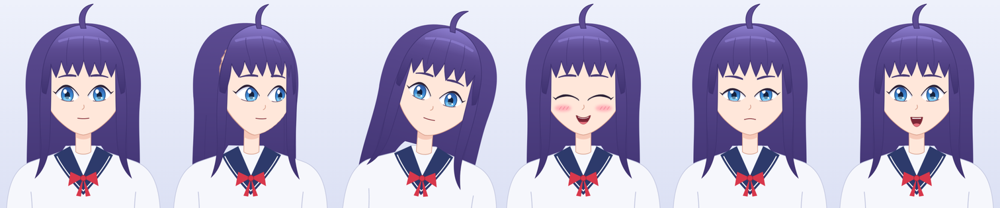

# liv2d

A web runtime that animates 2D illustrations the way Live2D does. It has no dependencies and runs on WebGL2.
All rigging lives in code (`models/<name>/rig.js`), so you don't need the Cubism Editor.



> The character you see right now is a **temporary placeholder** (SVGs generated by `tools/gen-placeholder.mjs`).
> Once the real character image comes in, it gets split into parts and a new rig is built for it.

## Running it

```bash
npm run dev          # http://localhost:5173
```

- Moving the mouse makes the head, eyes and body follow. When the pointer is idle, the character looks around on its own.
- She blinks, breathes, and her hair sways with physics (front, side and back hair, plus the ahoge).
- Toolbar: expressions (neutral/smile/happy/surprised/angry/sad), mesh wireframe, microphone lip sync, parameter panel
- Parameter panel: drag a slider to lock that value manually. Double-click a row to hand it back to automatic control.
- URL options: `?wire` (start with the wireframe on), `?still` (stop animation), `?model=<folder name>`

```bash
npm test             # engine unit tests
npm run snapshot     # render the preset poses to out/*.png with headless Chromium (needs Playwright)
```

## Structure

```
src/engine/          rigging runtime (DOM-independent, except loader/renderer)
  params.js          parameter table
  keyform.js         keyform multilinear interpolation (combined keys over several parameters, e.g. eye open × smile)
  deformers.js       warp (lattice), rotation, head3d (pseudo-3D head)
  physics.js         pendulum physics (same idea as Cubism physics3)
  mesh.js            automatic mesh generation from each layer's alpha
  model.js           rig description → runtime model
  loader.js          load images, crop, generate meshes
  renderer.js        WebGL2 rendering, clipping masks, wireframe
src/app/             web app (animator, UI)
models/placeholder/  temporary character: rig.js + geometry.js + parts/*.svg
tools/               dev server, placeholder generator, snapshots
```

### How the rig works

Same concepts as Live2D Cubism:

| Cubism | liv2d |
|---|---|
| ArtMesh | the `parts` entries (meshes are generated automatically from the image alpha) |
| Warp deformer | `type: 'warp'`: moves a lattice of control points |
| Rotation deformer | `type: 'rotation'` |
| Keyforms | `keys`: a keyform per parameter key value. Multiple parameters blend multilinearly. |
| Clipping mask | `clip: ['partId']` |
| physics3.json | `physics` |
| (none) | `type: 'head3d'`: puts the face on a dome and turns it, which gives the ±30° head-turn effect automatically |

Keyforms are written as functions. For example, eye closing is authored as "move each vertex down to the closed eyelid line":

```js
{ params: ['ParamEyeLOpen', 'ParamEyeLSmile'], keys: [[0, 1], [0, 1]],
  forms: [closed, null /* default */, closedSmile, openSmile] }
```

Parameter IDs follow Cubism's standard names (`ParamAngleX`, `ParamEyeLOpen`, `ParamMouthOpenY`, …).

## Plan for the real character (single illustration → rig)

1. **Split into parts**: from the source image, cut out the back hair / body / neck / face / eye white / iris / upper and lower lashes / brows / nose / mouth / front hair / side hair and so on as separate layers
2. **Fill hidden areas**: paint in the areas that were never drawn in the original but show up when things move (inpainting), such as the forehead under the bangs, the iris under the eyelids, the inside of the mouth and the back hair behind the neck
3. **Landmarks**: record the eye, eyelid, mouth and head outline coordinates in `geometry.js`
4. **Rig**: adapt `rig.js` to the new part layout and tune the deformers, keyforms and physics
5. Check each pose with `npm run snapshot`
